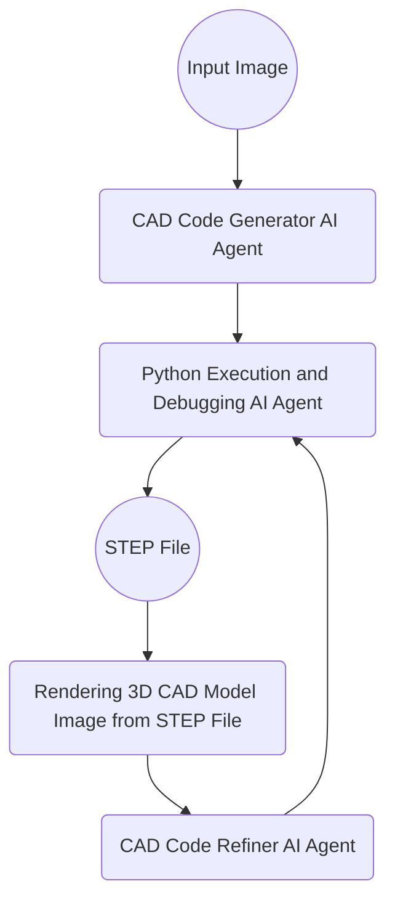

# cad3dify

Using GPT-5 (or Claude 4.5 opus, Gemini 3 pro, Llama 3.2 on Vertex AI), generate a 3D CAD model (STEP file) from a 2D CAD image.

> [!NOTE]
> We developed an agent-based version of this project called [agent3dify](https://github.com/neka-nat/agent3dify).
> You can use it instead of this project.

## Getting started

Installation.

```bash
git clone git@github.com:neka-nat/cad3dify.git
cd cad3dify
poetry install
```

Run script.
A STEP`file ("output.step") will be generated.

```bash
cd scripts
export OPENAI_API_KEY=<YOUR API KEY>
python cli.py <2D CAD Image File>
```

Or run streamlit spp

```bash
streamlit run scripts/app.py
streamlit run scripts/app.py -- --model_type claude  # Use Claude 4.5 sonnet
streamlit run scripts/app.py -- --model_type gemini  # Use the configured Gemini model
streamlit run scripts/app.py -- --model_type llama  # Use Llama 3.2 on Vertex AI
```

## Optional local OCR

The Streamlit app accepts PNG/JPEG drawings. Start it from the repository root:

```sh
python -m streamlit run scripts/app.py -- --model_type gemini
```

Install the Tesseract executable separately (on macOS: `brew install tesseract`).
Open the optional local OCR panel, enter a crop in original-image pixels, and run
OCR. Review the crop, correct the recognized text, and explicitly select the rows
to include. Unselected rows are never added to the generation prompt. The original
full-image code generation prompt is unchanged when no rows are selected.

The downloadable OCR record contains source and crop SHA-256 hashes, original
pixel coordinates, raw text, confidence values, and the user's corrections. OCR
confidence is not dimensional verification; symbols and stacked tolerances can be
misread. Backend failures and empty results are reported explicitly.

Gemini code runs through the existing direct Python execution path. Refinement is
disabled by default. STEP existence and basic shape validity checks do not establish
agreement with the drawing. An improvement in final STEP accuracy has not yet been
demonstrated for the optional OCR supplement.

See the [drawing evidence prompt](docs/drawing-evidence-prompt.zh-TW.md) for manual
review guidance. It is a reference document, not an automatic replacement for the
CAD generation prompt. PDF parsing and automatic tolerance extraction are not
integrated into this app.

## Architecture



## Demo

We will use the sample file [here](http://cad.wp.xdomain.jp/).

### Input image


### Generated 3D CAD model


